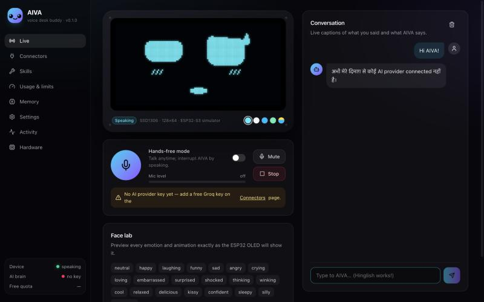
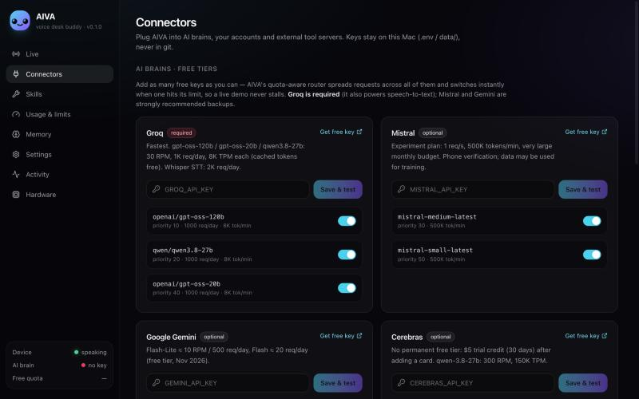
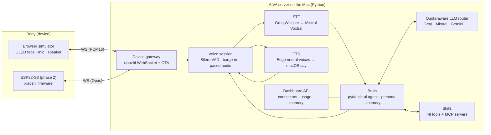

# AIVA — a voice-first AI desk companion

**AIVA** is a little desk robot you can *talk to like a person*: an ESP32-S3 with a
microphone, a speaker and a 128×64 OLED face that reacts with emotions — and a
"brain" running on a MacBook that can actually **do things**: search the web, play
YouTube, check and send Gmail, make and edit PDFs, set timers, control the Mac,
count to 100, crack Hinglish jokes, and plug into any MCP tool server.

> Phase 1 (this repo, working): the brain + a pixel-exact **browser simulator** of
> the device (face, mic, speaker). Phase 2: the real ESP32-S3 body, which speaks the
> same protocol — see [docs/HARDWARE.md](docs/HARDWARE.md).

| Live (simulator) | Connectors |
|---|---|
|  |  |

## Highlights

- **Talks Hinglish naturally** — Groq Whisper STT, free Microsoft Edge neural voices
  (Hindi + Indian English), streaming so the first word plays in ~1 s.
- **21 emotions on an OLED face** — the LLM tags its own mood (`<happy>`, `<sad>`…);
  eyes are a port of [esp32-eyes](https://github.com/playfultechnology/esp32-eyes), plus mouths,
  lip-sync, hearts, tears, sunglasses, Zzz and 11 animations (dance, nod, dizzy…).
- **Never runs out mid-demo** — a quota-aware router spreads requests across several
  free LLM tiers (Groq, Mistral, Gemini, Cerebras, OpenRouter), reads their
  rate-limit headers, skips exhausted models instantly, and **AIVA says out loud**
  when today's free quota is getting low.
- **49 built-in skills + MCP** — web, news, YouTube, Wikipedia, weather, currency,
  timers/reminders, notes, to-dos, Mac apps/volume/battery/screenshots/music, files,
  PDFs (create incl. Hindi, read, merge, split, rotate, watermark), Gmail, fun stuff.
  Add any [MCP](https://modelcontextprotocol.io) server (e.g. Playwright browser control) from the dashboard.
- **Safe by design** — sending email needs your spoken "yes" in a *later* turn (the
  model can't confirm for you), file access is sandboxed, no shell tool, keys never
  leave the Mac.
- **Hardware-ready** — the server speaks the protocol of the open-source
  [xiaozhi-esp32](https://github.com/78/xiaozhi-esp32) firmware, whose
  `bread-compact-wifi` board is exactly ESP32-S3 + I²S mic + MAX98357A + SSD1306.

## Architecture



Full design, data flow and the reasoning behind every choice: [docs/ARCHITECTURE.md](docs/ARCHITECTURE.md).
Research on free LLM tiers and the open-source projects evaluated: [docs/RESEARCH.md](docs/RESEARCH.md).

## Quick start (macOS)

Prerequisites: [uv](https://docs.astral.sh/uv/) and Node.js 20+ (`brew install uv node`).

```bash
git clone https://github.com/UserAkku/aiva.git && cd aiva
```

```bash
make setup
```

```bash
make run
```

Then open <http://localhost:8000>, go to **Connectors** and paste at least a free
**Groq** key (also add **Mistral** and **Gemini** for extra free quota). Keys are
saved to `.env` on your Mac. Back on **Live**: hold the mic button (or the Space
bar) and talk, or switch on **hands-free**.

Before showing it to anyone, run the readiness check (also in Settings):

```bash
uv run aiva doctor --deep
```

Other commands: `uv run aiva chat` (text chat in the terminal), `uv run aiva say "नमस्ते"`,
`make test`, `make dev` (hot-reload UI on :5173).

## Things to say

| Say | What happens |
|---|---|
| "Hi AIVA, apna introduction do" | Introduces herself, happy face |
| "1 से 100 तक गिनती करो" | Counts aloud via a tool (zero LLM tokens for the numbers) |
| "Aaj Mumbai ka weather kaisa hai?" | Open-Meteo forecast |
| "YouTube pe Kesariya chalao" | Finds and plays it in the browser |
| "Make a PDF on the solar system for class 6" | Formatted PDF, opens in Preview |
| "Mera inbox check karo" → "Riya ko mail bhejo…" → "haan bhej do" | Gmail with spoken confirmation |
| "10 minute ka chai timer lagao" | Announces when done |
| "Dance karke dikhao!" / "Gussa wala face banao" | Face animations |
| "Kitni free limit bachi hai?" | Reads the live quota |

## Project layout

```
src/aiva/
  llm/          quota guard, provider catalog, quota-aware router (pydantic-ai)
  brain/        agent, persona, memory, skill routing, confirmation gate
  tools/        49 skills: core, web, info, productivity, mac, files, pdf, gmail, fun
  connectors/   Gmail (IMAP/SMTP app password), MCP server manager
  voice/        Silero VAD, STT (Groq/Mistral), streaming TTS (Edge/say)
  devices/      xiaozhi-compatible gateway, voice session state machine, speaker
  api/          dashboard REST + live events
web/src/
  face/         OLED face engine (framebuffer, esp32-eyes port, expressions)
  device/       virtual ESP32: protocol client, mic worklet, audio player
  pages/        Live, Connectors, Skills, Usage, Memory, Settings, Activity, Hardware
config/aiva.yaml   defaults (providers, models, voices, VAD) — dashboard edits go to data/
docs/              architecture, research, protocol, hardware, demo script
tests/             router/quota + end-to-end device tests (incl. real speech through VAD)
```

## Credits

Built by standing on open-source shoulders — pydantic-ai, FastAPI, Silero VAD,
edge-tts, PyMuPDF, ddgs, trafilatura, xiaozhi-esp32, esp32-eyes and more. See
[THIRD_PARTY_NOTICES.md](THIRD_PARTY_NOTICES.md).

Licensed under **AGPL-3.0-or-later** (compatible with PyMuPDF and the esp32-eyes port).
