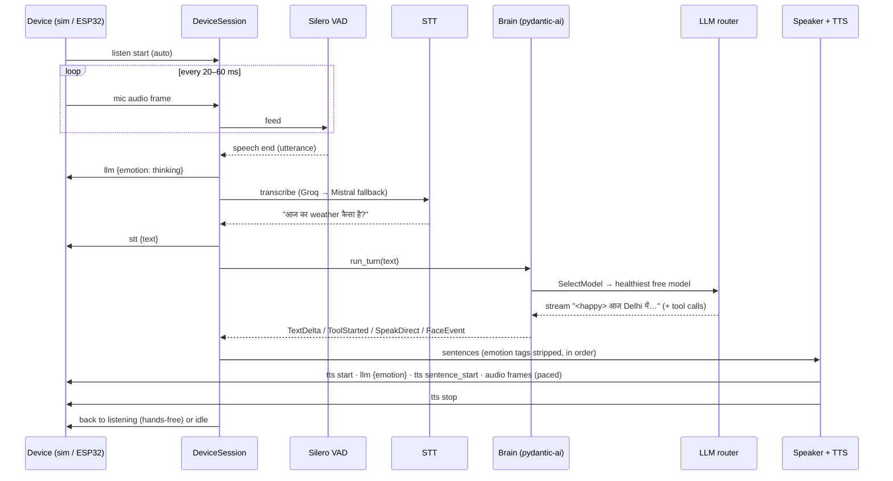

# AIVA architecture

AIVA splits into a **body** (any device that can hear, speak and show a face) and a
**brain** (a Python server on the Mac). They talk over one WebSocket protocol, so the
body can be swapped — browser simulator today, ESP32-S3 tomorrow — without touching
the brain.

## Layers

| Layer | Package | Responsibility | Built on |
|---|---|---|---|
| Body | `web/src/device`, `web/src/face` | Mic capture, playback, OLED face | Web Audio, AudioWorklet, pycozmo procedural-face port |
| Gateway | `aiva.devices.gateway` | xiaozhi WebSocket handshake, OTA endpoint, auth | FastAPI |
| Voice session | `aiva.devices.session`, `.speaker` | Turn-taking state machine, barge-in, ordered paced speech | Silero VAD |
| Speech | `aiva.voice` | STT with fallback, emotion-aware streaming TTS with fallback | Groq Whisper, Mistral Voxtral, Sarvam Bulbul, edge-tts, macOS `say` |
| Brain | `aiva.brain` | Agent loop, persona, memory, skill routing, confirmation gate | pydantic-ai |
| LLM | `aiva.llm` | Free-tier catalog, quota guard, quota-aware router | pydantic-ai `SelectModel` + `ModelFallback` |
| Skills | `aiva.tools`, `aiva.connectors` | 49 tools, Gmail, MCP servers | ddgs, trafilatura, PyMuPDF, Open-Meteo, MCP |
| Control | `aiva.api`, `web/src/pages` | Connectors, usage, memory, settings, live events | FastAPI + React |
| Storage | `aiva.storage` | Facts, notes, todos, reminders, usage, turn log | SQLite (WAL) |

`aiva.services.Services` is the composition root: it builds every service once and
hot-reloads the ones that depend on config/keys when the dashboard changes them.

## One voice turn

Latency budget (TTS measured on the dev MacBook Pro M3; the other figures are typical values to
verify with the Usage page, which logs every stage per turn):
end-of-speech detection 650 ms · Groq Whisper ≈ 300–500 ms · first LLM token ≈ 300–600 ms ·
first Edge TTS audio ≈ 1.1 s (progressive MP3 decode, measured) → **first audible word ≈ 2.5 s** after you stop talking.
Each later sentence is synthesised while the previous one plays, so there are no gaps.

## Key decisions

### 1. The device protocol *is* the xiaozhi protocol
[xiaozhi-esp32](https://github.com/78/xiaozhi-esp32) (MIT, ~34k★) is the most popular
open-source ESP32 voice-assistant firmware, and its `bread-compact-wifi` board config is
exactly this project's hardware (ESP32-S3 + I²S mic + MAX98357A + SSD1306 128×64). By
implementing its WebSocket protocol (`hello`/`listen`/`stt`/`llm`/`tts`/`abort`, Opus) on
the server — plus a `pcm16` extension for the browser — phase 2 needs a flash and a URL,
not a new firmware. Its 21 emotion names are AIVA's emotion vocabulary end to end.

### 2. Cascaded voice pipeline (VAD → STT → LLM → TTS), not speech-to-speech
Free speech-to-speech APIs are scarce and opaque. A cascade lets every stage use the best
*free* provider, fall back independently, and expose text for emotions, tools, captions
and safety checks.

### 3. A quota-aware router instead of one "best" free API
No single free tier survives a lively demo (Nov 2026: Groq ≈ 1K requests/day and 8K
tokens/min per model; Gemini Flash ≈ 20/day; Cerebras dropped its permanent free tier).
`QuotaGuard` merges rate-limit headers with local accounting; `GuardedModel` refuses
exhausted deployments without a network call; pydantic-ai's `SelectModel` picks the best
deployment per request step and `ModelFallback` retries on 429/5xx/timeouts or a slow first
token. Threshold crossings become sentences AIVA speaks. Details in [RESEARCH.md](RESEARCH.md).

### 4. Token diet for 8K-tokens/minute tiers
* Skill categories + keyword routing (English, Hinglish, Devanagari) expose ~10–20 tool
  schemas per turn instead of 49; `load_skills` loads more on demand.
* History is trimmed by whole user turns; old tool outputs are shortened.
* `count_numbers` speaks directly (`SpeakDirect`): counting to 100 costs zero output tokens.
* Static prompt prefix first (Groq doesn't count cached tokens against limits).

### 5. Emotions are inline tags
The model starts its reply with `<happy>` and may switch before any sentence. A streaming
parser strips tags from speech and turns them into `llm` emotion messages *in sentence
order*, so the face changes exactly when that sentence is spoken.

### 6. Server-side VAD, server-paced audio
Silero VAD v6 (ONNX, no torch) runs on the server for every device, so the ESP32 only
streams audio. TTS audio is sent at real-time speed with a small lead (~350 ms): devices
need tiny buffers and an interruption stops AIVA almost instantly. Devices with echo
cancellation (the browser) get barge-in through a stricter second VAD while AIVA speaks.

### 7. Safety
* Irreversible tools (sending email) use a two-step **confirmation gate**: the first call
  only prepares; execution needs the user's own affirmative words in a *later* turn.
* File tools are sandboxed to the AIVA workspace, Downloads, Documents and Desktop.
* No shell/code-execution tool; Mac control uses fixed commands with arguments as data.
* Secrets live in `.env` / `data/` (0600, git-ignored); the dashboard only ever shows masked keys.

## Failure handling

| Failure | What happens |
|---|---|
| LLM 429 / quota exhausted | Next deployment in microseconds; cooldown from `retry-after` / reset headers |
| LLM slow to start | `first_event_timeout` (6 s) → fallback |
| Every LLM down | AIVA says so in a sentence (never silent) |
| Groq STT down | Mistral Voxtral (Hindi supported) |
| Sarvam / Edge TTS down | next engine in the chain (Sarvam → Edge → macOS `say`); per-engine circuit breaker for 60 s |
| Whisper hallucination on noise | Segment filtering by no-speech probability + junk-phrase filter |
| Device disconnects | Turn cancelled, history keeps an "(interrupted)" note; browser auto-reconnects |
| Edge TTS partially spoken then fails | Stops cleanly (no repeated audio) |

## Extending

* **New tool**: add a function with a docstring under a category in `src/aiva/tools/*.py`
  (`@reg.tool("web")`). Typed args become the JSON schema automatically.
* **New free provider/model**: add a deployment to `config/aiva.yaml` (OpenAI-compatible
  endpoints work via `provider: openai_compatible` + `base_url` + `api_key_env`).
* **New account / service**: add an MCP server from the Connectors page.
* **New body**: anything that speaks [PROTOCOL.md](PROTOCOL.md) — a Raspberry Pi, a phone app, a different MCU.
